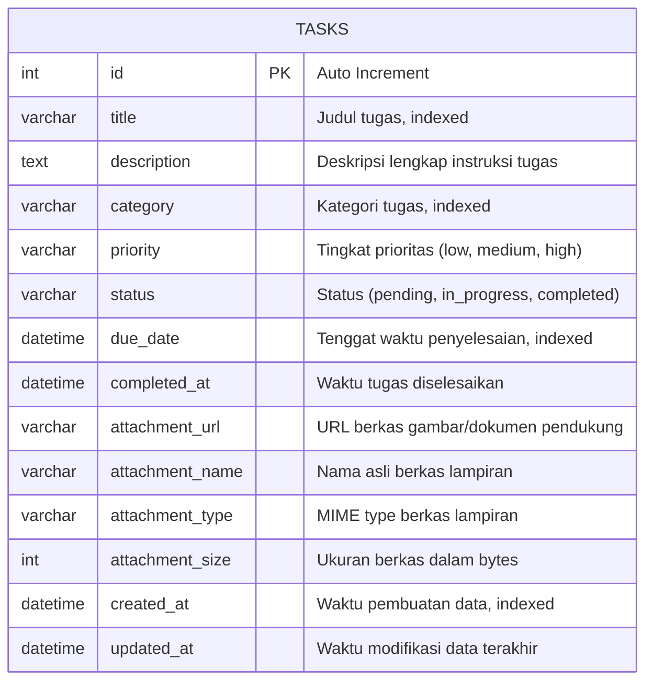

# Arsitektur Sistem CIMB NIAGA TaskFlow

Dokumen ini menjelaskan rancangan arsitektur perangkat lunak, pola desain (*design patterns*), struktur database, serta standar *best practices* yang diterapkan pada modul web pencatatan tugas harian **PT Bank CIMB Niaga Tbk**.

---

## 1. Gambaran Umum Sistem

Sistem TaskFlow dibangun dengan arsitektur **Client-Server Terpisah (Decoupled Architecture)** melalui RESTful API dan Static File Serving:
- **Frontend Layer**: Single Page Application (SPA) berbasis **Vue.js 3** + **Vite** + **Tailwind CSS**, dengan identitas korporat Bank CIMB Niaga.
- **Backend Layer**: RESTful API berbasis **Python 3** menggunakan framework modern **FastAPI**, **SQLAlchemy ORM**, dan **Pydantic v2**.
- **Attachment Subsystem**: Pengelolaan berkas biner (gambar PNG/JPG & dokumen PDF/Office) dengan penyimpanan terisolasi di `backend/uploads/` dan disajikan via ASGI StaticFiles.
- **Database Layer**: **MySQL 8.0** sebagai relational database storage dengan kolom terindeks optimal.

```
+-------------------------------------------------------+
|               Client Browser (Desktop / Mobile)       |
+-------------------------------------------------------+
          │                                  │
          │ REST API (JSON)                  │ Static Files (/uploads)
          ▼                                  ▼
+-------------------------------------------------------+
|               Frontend (Vue.js 3 + Vite)              |
|  - Components: Navbar, StatsCards, FilterBar, Cards   |
|  - Modals: TaskModal, TaskDetailModal, ConfirmModal   |
|  - Services: Axios API Client & Multipart Uploader    |
+-------------------------------------------------------+
                           │
                           │ HTTP RESTful API (Port 8000)
                           ▼
+-------------------------------------------------------+
|               Backend (FastAPI Layer)                 |
|  - Routers: Endpoint Routing & Multipart Upload       |
|  - Static Files Mount: /uploads                       |
|  - Schemas: Pydantic Data Validation & Serialization   |
|  - CRUD / Repository: Business Logic & Queries        |
|  - Models: SQLAlchemy ORM Entities                    |
+-------------------------------------------------------+
          │                                  │
          │ PyMySQL Connection (Port 3306)   │ Local Disk I/O
          ▼                                  ▼
+-------------------------+        +--------------------+
|  Database (MySQL 8.0)   |        |  File Storage      |
|  - Database: daily_tasks|        |  backend/uploads/  |
|  - Table: tasks         |        |  (UUID sanitized)  |
+-------------------------+        +--------------------+
```

---

## 2. Pola Desain Backend (Layered Architecture)

Backend menerapkan **Separation of Concerns (SoC)** dengan struktur berlapis:

1. **Config Layer (`app/core/config.py`)**:
   - Memusatkan konfigurasi environment, path direktori unggahan (`UPLOAD_DIR`), koneksi database, dan aturan CORS.
2. **Database Session Layer (`app/core/database.py`)**:
   - Engine SQLAlchemy dengan *connection pooling* (`pool_size=10`, `max_overflow=20`), `pool_pre_ping=True` (mencegah *broken connections*), dan `pool_recycle=3600`.
   - Dependency injection `get_db()` yang otomatis menutup session saat request selesai.
3. **Data Model Layer (`app/models/task.py`)**:
   - Representasi relasional tabel `tasks` dengan dukungan lampiran dokumen/gambar (`attachment_url`, `attachment_name`, `attachment_type`, `attachment_size`).
4. **Data Transfer Object / Schemas Layer (`app/schemas/task.py`)**:
   - Validasi data masukan pengguna secara ketat menggunakan Pydantic v2.
   - Menjamin bahwa judul tidak boleh kosong atau hanya berupa spasi.
5. **Repository / CRUD Layer (`app/crud/task.py`)**:
   - Memusatkan query database: filter dinamis (status, prioritas, kategori, overdue), pencarian teks bebas (*ilike*), dan pengurutan (*sorting*).
6. **Controller / Router Layer (`app/routers/task.py`)**:
   - Mengatur HTTP route mapping, kode status respon HTTP (200, 201, 204, 404, 400), dan *multipart file upload handler*.

---

## 3. Skema Database (ERD & Kamus Data)

### Entity Relationship Diagram (ERD)



### Kamus Data (Data Dictionary)

| Nama Kolom | Tipe Data | Nullable | Default | Keterangan |
|---|---|---|---|---|
| `id` | INT | NO | AUTO_INCREMENT | Primary Key unik tiap tugas |
| `title` | VARCHAR(255) | NO | - | Judul tugas harian (wajib, max 255 karakter, indexed) |
| `description` | TEXT | YES | NULL | Rincian detail instruksi tugas |
| `category` | VARCHAR(60) | NO | 'Umum' | Kategori tugas (Pekerjaan, Rapat, Proyek, Pribadi, dll) |
| `priority` | ENUM / VARCHAR(20) | NO | 'medium' | Prioritas: `'low'`, `'medium'`, `'high'` |
| `status` | ENUM / VARCHAR(20) | NO | 'pending' | Status: `'pending'`, `'in_progress'`, `'completed'` |
| `due_date` | DATETIME | YES | NULL | Batas waktu penyelesaian tugas (indexed) |
| `completed_at` | DATETIME | YES | NULL | Waktu timestamp ketika status berubah jadi completed |
| `attachment_url` | VARCHAR(500) | YES | NULL | Path static URL berkas lampiran pendukung |
| `attachment_name` | VARCHAR(255) | YES | NULL | Nama asli berkas (misal: `laporan_keuangan.pdf`) |
| `attachment_type` | VARCHAR(100) | YES | NULL | MIME type berkas (misal: `image/png`, `application/pdf`) |
| `attachment_size` | INT | YES | NULL | Ukuran berkas dalam satuan bytes |
| `created_at` | DATETIME | NO | CURRENT_TIMESTAMP | Waktu pembuatan data tugas (indexed) |
| `updated_at` | DATETIME | NO | CURRENT_TIMESTAMP | Waktu pembaruan data terakhir (*auto-update*) |

---

## 5. Standarisasi Zona Waktu (WIB - UTC+7)

- Seluruh timestamp pada server FastAPI dan database MySQL diselaraskan menggunakan zona waktu lokal **WIB (Waktu Indonesia Barat / Asia/Jakarta / UTC+7)**.
- Hal ini mencegah anomali perbedaan waktu 7 jam antara waktu server UTC dengan waktu lokal pengguna di Indonesia.
- Pada sisi klien (Frontend), utilitas terpusat `src/utils/dateFormatter.js` memastikan representasi tanggal, jam, dan menit selalu konsisten berformat `DD MMM YYYY, HH:mm WIB`.

---

## 6. Standar Responsivitas Antarmuka (Mobile & Multi-Device)

- **Mobile First Breakpoints**: Menggunakan sistem grid responsif Tailwind CSS (`xs: <480px`, `sm: >=640px`, `md: >=768px`, `lg: >=1024px`).
- **Touch-Friendly Targets**: Tombol aksi dan checkbox memiliki dimensi minimal 36px–44px untuk kemudahan interaksi sentuhan layar (*mobile thumbs*).
- **Adaptive Layout**: Filter bar otomatis berubah dari baris horizontal di desktop menjadi layout 2-kolom kompak di layar smartphone tanpa menyebabkan *horizontal scrolling* yang tidak diinginkan.
- **Scrollable Modal & Overflow Protection**: Modal detail dan form pembuatan tugas dilengkapi batas tinggi maksimal (`max-h-[85vh]`) dengan scrolling halus agar nyaman digunakan pada orientasi vertikal maupun horizontal (*landscape*).

1. **Sanitasi Nama Berkas**:
   - Nama berkas asli disanitasi menggunakan ekspresi reguler untuk menghilangkan karakter terlarang (*path traversal*).
   - Diberi prefix acak `uuid.uuid4().hex[:10]` agar tidak terjadi tumpang tindih nama antar unggahan.
2. **Validasi Ukuran Berkas**:
   - Sistem membatasi ukuran berkas maksimal **10 MB** untuk mencegah *Denial of Service* (DoS) pada kapasitas disk server.
3. **Pembersihan Berkas Otomatis (*Disk Cleanup*)**:
   - Jika pengguna mengunggah berkas baru untuk tugas yang sudah memiliki lampiran, berkas lama otomatis dihapus dari disk.
   - Jika suatu tugas dihapus, berkas lampiran fisiknya juga otomatis dihapus dari disk server.
