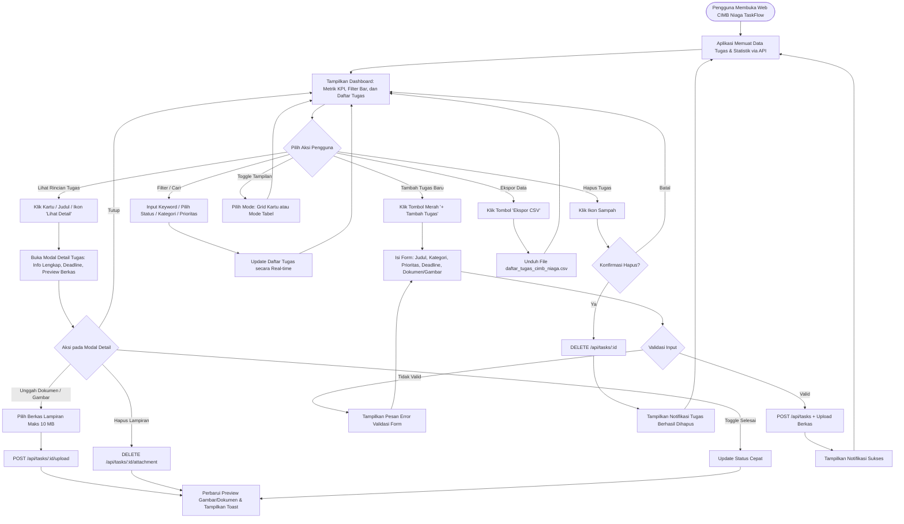
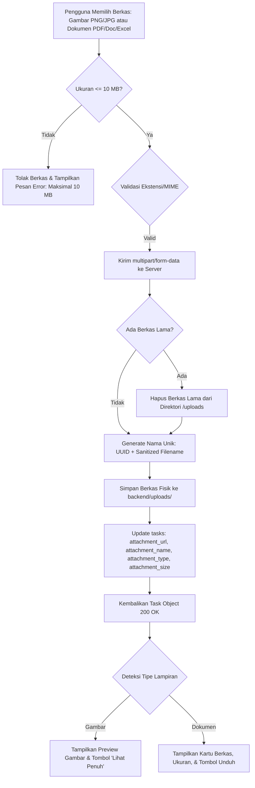
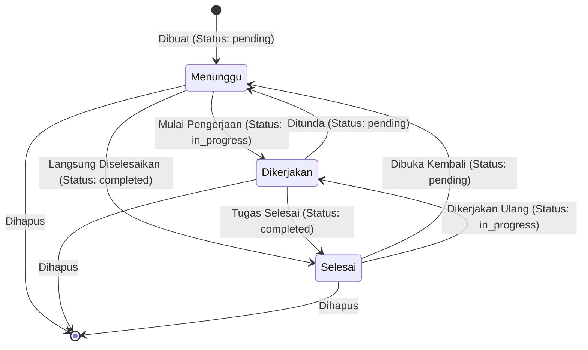
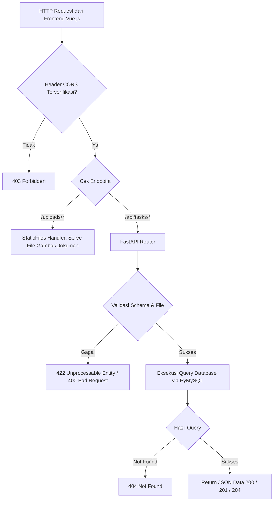

# Diagram Alur Sistem (Flowcharts) - CIMB NIAGA TaskFlow

Dokumen ini memuat diagram alur (*flowcharts*) yang mendokumentasikan interaksi pengguna, alur navigasi detail tugas, siklus hidup dokumen/gambar pendukung, dan alur permintaan API pada modul tugas harian **PT Bank CIMB Niaga Tbk**.

---

## 1. Alur Interaksi Pengguna (User Journey Flowchart)

---

## 2. Alur Pengelolaan Berkas Lampiran (Attachment Flowchart)

---

## 3. Alur Siklus Hidup Tugas (Task State Transition)

---

## 4. Alur Permintaan HTTP & Penanganan Backend

